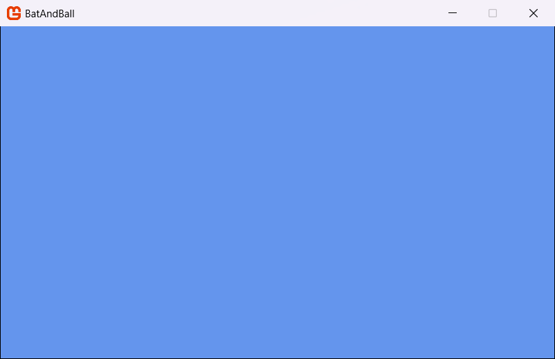

In this step, you create a project using the *MonoGame Empty Game* (Single Project) template. This template makes one solution that contains:

- One shared folder for your game code.
- One Content Builder project for your game content.
- One project for each platform that you select.

You write your game code one time. Each platform project then builds the same code for all platforms.

In this step, you will:

- Select the platforms for your game.
- Create a new MonoGame project with the name `BatAndBall`.
- Build and run the project.

## Select your platforms

A *platform* is a type of device or graphics system that your game operates on. When you create the project, you select the platforms with the `--Platforms` option, the template then makes one project containing each platform that you have selected.

These are the platforms that the template supports:

| Value | Platform | Operates on |
| --- | --- | --- |
| `vk` | DesktopVK (Vulkan) | Windows, macOS and Linux |
| `dx12` | WindowsDX12 (DirectX 12) | Windows only |
| `gl` | Legacy DesktopGL (OpenGL) | Windows, macOS and Linux |
| `dx` | Legacy WindowsDX (DirectX 11) | Windows only |
| `android` | Android | Android phones and tablets |
| `ios` | iOS | iPhone and iPad |

This guide focuses on the two newer desktop platforms, *DesktopVK* (Vulkan) and *WindowsDX12*.

> [!IMPORTANT]
> WindowsDX12 operates only on Windows. If you are building from macOS and Linux, select **only** DesktopVK.

> [!NOTE]
> DesktopVK needs a graphics driver that supports Vulkan. If your DesktopVK game does not start, update your graphics driver, or use DesktopGL.

You can select more than one platform. Separate the values with spaces, for example `--Platforms vk dx12 android ios`. For more information about each platform, refer to [Supported Platforms](../../../getting_started/platforms.md).

## Create the project

> [!NOTE]
> Use only letters and numbers in the project name. Do not start the name with a number and do not use spaces.  These are `.NET`'s rules, not ours.

1. Open a terminal in the folder where you keep your projects.
2. Run the command for your operating system:

### [Windows](#tab/windows)

```sh
dotnet new monogame -n BatAndBall --Platforms vk dx12
```

### [macOS](#tab/macos)

```sh
dotnet new monogame -n BatAndBall --Platforms vk
```

### [Linux](#tab/linux)

```sh
dotnet new monogame -n BatAndBall --Platforms vk
```

---

The command creates the project in a new `BatAndBall` folder.

> [!TIP]
> The template also has the short name `mg-emptygame`. Use this name if a different template also uses the name `monogame` in your environment.

### Fallback: create the project without a platform selection

If you do not select platforms, the template will create a project for *DesktopGL* only.  DesktopGL uses basic OpenGL, which operates on Windows, macOS and Linux, so use this method if your graphics driver does not support Vulkan. You can also use it to create the project from the new project dialog of your IDE.

> [!NOTE]
> The new project dialogs do not always show the platform options. If the dialog does not show them, the project has DesktopGL only. To use DesktopGL in this guide, use `DesktopGL` in all the places where the guide shows `DesktopVK`.

To create a DesktopGL project:

#### [Visual Studio](#tab/vs)

1. Start Visual Studio.
2. Click *Create a new project*.
3. In the search box, type `MonoGame Empty Game`.
4. Select the *MonoGame Empty Game* template. Then, click *Next*.
5. In *Project name*, type `BatAndBall`.
6. In *Location*, select the folder for your project.
7. Click *Create*.

#### [Visual Studio Code](#tab/vscode)

1. Start Visual Studio Code.
2. Open the *Command Palette*. Press `Ctrl+Shift+P` (on macOS, `Cmd+Shift+P`).
3. Type `.NET: New Project`. Then, select the *.NET: New Project* command.
4. Type `MonoGame` to filter the list. Then, select *MonoGame Empty Game*.
5. Select the folder for your project.
6. Type `BatAndBall` as the project name. Then, press `Enter`.
7. Select *Create project*.

#### [Rider](#tab/rider)

1. Start Rider.
2. Click *New Solution*.
3. In the list of templates, select *MonoGame Empty Game*. If you cannot find it, look in the *Custom Templates* section.
4. In *Solution name*, type `BatAndBall`.
5. In *Solution directory*, select the folder for your project.
6. Click *Create*.

#### [dotnet CLI](#tab/dotnetcli)

Run the command without the `--Platforms` option:

```sh
dotnet new monogame -n BatAndBall
```

---

## Open the project in your IDE

If you created the project from your IDE, the IDE opens the project automatically. Go to the next section.

### [Visual Studio](#tab/vs)

1. Start Visual Studio.
2. Click *Open a project or solution*.
3. Go to the `BatAndBall` folder and select `BatAndBall.sln`. Then, click *Open*.

### [Visual Studio Code](#tab/vscode)

1. Start Visual Studio Code.
2. Select `File > Open Folder`.
3. Select the `BatAndBall` folder. Then, click *Open* (on macOS, *Select Folder*).

### [Rider](#tab/rider)

1. Start Rider.
2. Click *Open*.
3. Go to the `BatAndBall` folder and select `BatAndBall.sln`. Then, click *Open*.

### [dotnet CLI](#tab/dotnetcli)

You do not need an IDE to build and run the game. Use the terminal for the next section.

---

## Build and run the project

> [!IMPORTANT]
> The first build must build the full solution. The platform projects use the Content Builder project, so NuGet must restore all the projects first. Visual Studio and Rider restore the full solution when they open it.

### [Visual Studio](#tab/vs)

1. In the toolbar, select the *DesktopVK* launch profile. You can also select the *BatAndBall.DesktopVK* project as the startup project.
2. Press `F5` to build and run the game.

To run the WindowsDX12 version, select the *WindowsDX12* launch profile, then press `F5`.

### [Visual Studio Code](#tab/vscode)

1. Open a terminal in Visual Studio Code. Select `Terminal > New Terminal`.
2. Run this command to build the full solution one time:

    ```sh
    dotnet restore
    dotnet build
    ```

3. Open the *Run and Debug* view. Select `View > Run`.
4. In the list at the top of the view, select *BatAndBall (DesktopVK)*.
5. Press `F5` to run the game.

To run the WindowsDX12 version, select *BatAndBall (WindowsDX12)* in step 4.

### [Rider](#tab/rider)

1. In the run configuration list in the toolbar, select *BatAndBall.DesktopVK*.
2. Click the *Debug* icon in the toolbar to build and debug the game.

To run the WindowsDX12 version, select *BatAndBall.WindowsDX12* in step 1.

### [dotnet CLI](#tab/dotnetcli)

1. Go to the project folder:

    ```sh
    cd BatAndBall
    ```

2. Restore and build the full solution:

    ```sh
    dotnet restore
    dotnet build
    ```

3. Run the DesktopVK project:

    ```sh
    dotnet run --project Platforms/DesktopVK
    ```

> [!NOTE]
> To run the WindowsDX12 version on Windows, run `dotnet run --project Platforms/WindowsDX12`.

---

The game window opens. It shows a cornflower blue screen.

|  |
| :---: |
| **Figure 3-1: The empty MonoGame game window** |

This window is a complete MonoGame game that does nothing. MonoGame creates the window, starts the graphics device and runs the *game loop*. The game loop updates the game and draws it to the screen, many times each second. [Step 5](../05_understanding_the_code/index.md) explains the game loop.

To close the game, press `Esc`.

> [!NOTE]
> The DesktopVK version writes information about Vulkan to the terminal when it starts. This information is normal.

## Conclusion

In this step, you accomplished the following:

- You learned about the platforms that the template supports.
- You created a new MonoGame project for DesktopVK and WindowsDX12.
- You built and ran your first MonoGame game.

In the next step, you will add a texture, a sound effect and a font to your project.

## Test Your Knowledge

1. Which two platforms does this guide use?

    :::question-answer
    DesktopVK (Vulkan) and WindowsDX12 (DirectX 12).
    :::

2. Which of these two platforms operates only on Windows?

    :::question-answer
    WindowsDX12.
    :::

3. Which platform does the template create if you do not select platforms?

    :::question-answer
    DesktopGL. It operates on Windows, macOS and Linux.
    :::

4. Why must the first build have to restore the full solution first?

    :::question-answer
    The platform projects use the Content Builder project. NuGet must restore all the projects in the solution before one platform project can build.
    :::
