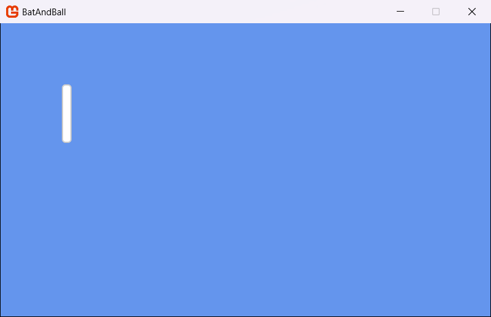

Games use *content*, such as images, sounds and fonts. MonoGame uses the *Content Pipeline* to convert your content files into a format that is optimized for each platform, the converted files have the `.xnb` extension which your game loads at runtime.

In MonoGame 3.8.6 and later, the *Content Builder* builds your content (replacing the legacy MGCB editor and tools). The Content Builder is a small C# project in your solution that reads your content files using defined rules that you write in C#. Then, it builds the content for the platform that you build.

In this step, you will:

- Add a texture, a sound effect and a font to the project.
- Write the rules that tell the Content Builder which files to build.
- Build the content.
- Load the texture and show it on the screen.

## The Content project

The "Empty Game" template puts the Content Builder project into the `Content` folder of your solution:

```text
BatAndBall/
├── Content/
│   ├── Assets/              # Put your content files here.
│   │   └── readme.txt
│   ├── Builder/
│   │   └── Builder.cs       # The rules that tell the builder which files to build.
│   ├── BuildContent.targets # Runs the builder when a platform project builds.
│   └── Content.csproj
├── Platforms/
├── Resources/
└── Source/
```

You do four things to add content:

1. Put the files in `Content/Assets`.
2. Add a rule for the files in `Builder.cs`.
3. Run your builder to compile your assets into `.xnb` files in your Game's output "Content" folder.
4. Load the files in your game code.

## Add the texture and sound files

1. Right-click each of these files and select *Save Link As...*. Save them in the `Content/Assets` folder of your project.
    - [bat.png](./files/bat.png){download}: the texture for the bats.
    - [ball.png](./files/ball.png){download}: the texture for the ball.
    - [hit.wav](./files/hit.wav){download}: the sound that plays when the ball hits a bat or an edge.

> [!NOTE]
> You can use these three files freely in your own projects.

## Add a font

MonoGame draws text with a *SpriteFont*. A SpriteFont (a `.spritefont` file) tells the Content Builder which font (file) to import, the size of the text and the characters to include. The Content Builder then makes a texture that contains all the characters.

> [!NOTE]
> By default, the `.spritefont` importer will use the requested font from those installed on the computer you build your content on.  However, if that machine does not have that font installed it will error.
>
> So, it is recommended to include the `ttf` font file for the font you wish to import alongside your `.spritefont`, which the Content Pipeline will alternatively use when generating the font asset.  This ensures whomever builds your game will always have the font to hand, especially useful when you use automation to automatically build your game for you.

The MonoGame templates include a SpriteFont template for the Content Builder.

To use it:

1. Open a terminal in the `Content/Assets` folder:
    - In Visual Studio, select `View > Terminal`, then go to the folder.
    - In Visual Studio Code, select `Terminal > New Terminal`, then go to the folder.
    - In Rider, select `View > Tool Windows > Terminal`, then go to the folder.
2. Run this `.NET` new item template command:

    ```sh
    dotnet new mgsf -n Score -o Fonts --IncludeFont
    ```

    The `mgsf` item template adds two files to the `Content/Assets/Fonts` folder:
    - `Score.spritefont`: the SpriteFont description.
    - `Roboto-Bold.ttf`: the font file that the SpriteFont uses.

3. Open `Content/Assets/Fonts/Score.spritefont` in your IDE.
4. Find the `<Size>` element. Change the value from `14` to `48`:

    ```xml
    <Size>48</Size>
    ```

5. Save the file.

The `Content/Assets` folder now contains these files:

```text
Content/Assets/
├── Fonts/
│   ├── Roboto-Bold.ttf
│   └── Score.spritefont
├── ball.png
├── bat.png
├── hit.wav
└── readme.txt
```

> [!TIP]
> Keep the font file in the `Assets` folder. If the `.spritefont` file uses the name of an installed system font, all developers and build computers must have that font installed.
>
> The font files do not need to be named the same as the `.spritefont` file itself, but it does need to have the `Name` property for the specific "Font" file in the `.spritefont` file for the Content Pipeline to locate it. (The Content Pipeline looks for a font by its name or its Filename using the `Name` property in the  `.spritefont` file)

## Add the content rules

The Content Builder builds nothing until you add rules. This makes sure that you decide which files are part of your game. You add one rule for each content file.

1. Open `Content/Builder/Builder.cs`.
2. Find the `GetContentCollection` method.
3. Add these four lines before the `return content;` line:

    ```cs
    content.Include("bat.png");
    content.Include("ball.png");
    content.Include("hit.wav");
    content.Include("Fonts/Score.spritefont");
    ```

4. Save the file.

Each of the `Include` rules above, adds one file to the content of your game. The path is relative to the `Assets` folder. The Content Builder uses the default importer and processor for each file type:

| File | Built as | Load as |
| --- | --- | --- |
| `bat.png`, `ball.png` | A texture | `Texture2D` |
| `hit.wav` | A sound effect | `SoundEffect` |
| `Fonts/Score.spritefont` | A font texture and the character data | `SpriteFont` |

You do not add a rule for `Roboto-Bold.ttf` as the `.spritefont` file uses the font file when the Content Builder builds the SpriteFont. The Content Builder also ignores `readme.txt`, because no rule includes it.

> [!NOTE]
> You can include all the files in the `Assets` folder with one rule:
>
> `content.Include<WildcardRule>("*");`
>
> Use this option only if you do not want to add a rule for each file. If you use this rule, you must also exclude the font file with `content.Exclude<WildcardRule>("Fonts/*.ttf");`, and remove files that are not content, such as `readme.txt`. For more information about rules, refer to [Setting up the Content Builder](../../../getting_started/content_pipeline/content_builder/setup.md).

## Build the content

Restore and then build the project. When a platform project builds, the Content Builder runs first. It puts the built `.xnb` files in the `Content` folder of the game output.

> [!NOTE]
> Currently, the Content Builder is an imported (not referenced) project, so by default, it does not restore its NuGet packages for a clean build like your Game project does.  You need to run a manual `dotnet restore` for the solution before the first build.  If building in VS Code, Rider or Visual Studio, those IDE's do this for you behind the scenes first automatically.

For DesktopVK, the output is in `Platforms/DesktopVK/bin/Debug/net10.0/Content`. For WindowsDX12, it is in `Platforms/WindowsDX12/bin/Debug/net10.0-windows/Content`. Each platform gets its own built content:

```text
Content/
├── Fonts/
│   └── Score.xnb
├── ball.xnb
├── bat.xnb
└── hit.xnb
```

> [!NOTE]
> If the Content Builder cannot build a file, it shows a warning or an error in the build output. A warning does not stop the build, so make sure that you read the build output if a file is missing.  (which normally appears as a `ContentLoadException` when you try and run your game and the Content Pipeline cannot find the asset.  9/10 times this is because you named the file differently to what you load it as, it is in a different path, or it errored at build time)

## Load and draw the texture

To make sure that the content is correct, we will load the `bat` texture and show it on the screen.

The name of each content item is the relative path to the `Assets` folder for the content, without the file extension.

For example:

- `bat.png` has the name `bat`
- `Fonts/Score.spritefont` has the name `Fonts/Score`.

Open `Source/Game1.cs`. Then, make these three changes:

1. Add a field to hold the bat texture, below the `_spriteBatch` field:

    [!code-csharp[](./snippets/game1.cs?start=9&end=11&highlight=3)]

    The type of the field is [**Texture2D**](xref:Microsoft.Xna.Framework.Graphics.Texture2D), which is a 2D image.

2. In `LoadContent`, load the texture:

    [!code-csharp[](./snippets/game1.cs?start=27&end=33&highlight=6)]

    [**Content.Load**](xref:Microsoft.Xna.Framework.Content.ContentManager.Load``1(System.String)) loads a built content item using its name to retrieve the asset, the `Texture2D` type tells MonoGame which type of content to load.

3. In `Draw`, draw the texture:

    [!code-csharp[](./snippets/game1.cs?start=49&end=59&highlight=6-8)]

    A [**SpriteBatch**](xref:Microsoft.Xna.Framework.Graphics.SpriteBatch) draws 2D images. `Begin` starts a group of draw calls, `Draw` adds the bat at position (100, 100), and `End` sends the group to the graphics device.

Save the file, then run the game. The game shows the bat on the cornflower blue screen.

|  |
| :---: |
| **Figure 4-1: The bat texture on the screen** |

[Step 5](../05_understanding_the_code/index.md) explains this code in more detail.

## Learn more about the Content Builder

This step shows only the basic tasks. For more information about the Content Builder, refer to these pages:

- [Content Builder, Part 1: Getting Started](../../../getting_started/content_pipeline/content_builder/index.md)
- [Content Builder, Part 2: Setting up the Content Builder](../../../getting_started/content_pipeline/content_builder/setup.md): rules, importers, processors and each type of content.
- [Content Builder, Part 3: Advanced Scenarios and Automation](../../../getting_started/content_pipeline/content_builder/advanced.md): platform specific content, custom importers and automated builds.
- [Content Builder, Part 4: Migrating from MGCB](../../../getting_started/content_pipeline/content_builder/migrating_from_mgcb.md): for projects that use the MGCB Editor.
- [Why use the Content Pipeline?](../../../getting_started/content_pipeline/why_content_pipeline.md)

## Conclusion

In this step, you accomplished the following:

- You added a texture, a sound effect and a font to the `Content/Assets` folder.
- You added one Content Builder rule for each content file.
- You loaded a texture and showed it on the screen.

In the next step, you will learn about the code in the project and the game loop.

## Test Your Knowledge

1. In which folder do you put your content files?

    :::question-answer
    In the `Content/Assets` folder.
    :::

2. What does the Content Builder build if you do not add rules to `Builder.cs`?

    :::question-answer
    Nothing. The Content Builder builds only the files that a rule includes.
    :::

3. Which rule adds the file `Assets/hit.wav` to your game?

    :::question-answer
    `content.Include("hit.wav");`
    :::

4. What name do you use to load the file `Assets/Fonts/Score.spritefont`?

    :::question-answer
    `Fonts/Score`. The name is the path relative to the `Assets` folder, without the file extension.
    :::

5. Why is there no rule for the `Roboto-Bold.ttf` file?

    :::question-answer
    The `.spritefont` file uses the font file when the Content Builder builds the SpriteFont. The font file is not content that the game loads.
    :::
