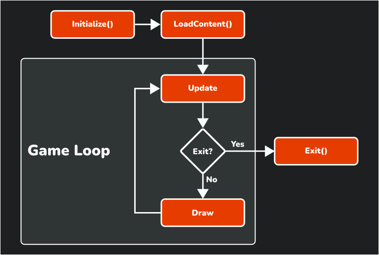

Before you make the game, it is important to know how a MonoGame project using the new "Empty Game" single project template is organized and how the code operates.

In this step, you will:

- Learn about the folders in the project.
- Learn about the start point of the game.
- Learn about each method in the `Game1` class.
- Learn about the game loop.

## The project folders

The MonoGame Empty Game template creates the following folders and files:

| Folder or file | Contents |
| --- | --- |
| `Source/` | Your game code. All platform projects build the files in this folder. Start with `Game1.cs`. |
| `Content/` | The Content Builder project. Your content files go in `Content/Assets`. |
| `Platforms/` | One project for each platform. Each project contains only the start point and the settings for its platform. |
| `Resources/` | The name, icons and other files that identify your game. `Resources/Identity.props` sets the name and version for all platforms. |
| `BatAndBall.sln` | The solution file. It contains all the projects. |
| `Directory.Packages.props` | The MonoGame version for all projects. |

Each platform project shares the code from the `Source` folder with this line in its `.csproj` file:

> [!NOTE]
> Not covered as part of this tutorial, but if you had a need to have platform-specific (non-shared) code in your project, then simply creating the file inside the `Project's` folder, the file will then only compile for that project alone, similar to the `program.cs` in each platform's folder.

```xml
<Compile Include="..\..\Source\**\*.cs" />
```

Thus, you write your game one time, and each platform project builds it.

> [!TIP]
> To change the MonoGame version for all projects, change the `MonoGameVersion` value in `Directory.Packages.props`.
>
> If you need to force the version of MonoGame for any project, simply replace `Version="$(MonoGameVersion)"` with the version you want that platform to use.

## The starting point

Each platform project has a small file that starts the game. For DesktopVK, this file is `Platforms/DesktopVK/Program.cs`, the WindowsDX12 project has the same file:

```cs
using BatAndBall;

using var game = new Game1();
game.Run();
```

This code makes an instance of your `Game1` class. Then, it calls `Run` to start the game. The `using` keyword makes sure that MonoGame releases the resources of the game when the game stops.

## The Game1 class

The shared `Source/Game1.cs` contains all the code for your game. In this section, we will explain each part of the file, along with the changes that you made in [Step 4](../04_adding_content/index.md).

Open the file in your IDE, so that you can see each part in its place.

The `Game1` class inherits from the MonoGame [**Game**](xref:Microsoft.Xna.Framework.Game) class. The `Game` class gives you the game window, the graphics device and the game loop.  You *override* these methods in your own copy, to add the code for your game.

> [!TIP]
> Remember, MonoGame is fully open source, and if you ever need to understand what any class, function or code does, you can inspect the [Source](https://github.com/MonoGame/MonoGame) or the [API Documentation](https://docs.monogame.net/api/index.html) to find out.

### The fields

[!code-csharp[](./snippets/game1.cs?start=9&end=11)]

- [**GraphicsDeviceManager**](xref:Microsoft.Xna.Framework.GraphicsDeviceManager) configures the graphics device. For example, it sets the size of the game window.
- [**SpriteBatch**](xref:Microsoft.Xna.Framework.Graphics.SpriteBatch) draws 2D images and text. It collects the draw calls and sends them to the graphics device together, to make drawing fast.
- `_batTexture` holds the texture that you loaded in Step 4.

### The constructor

[!code-csharp[](./snippets/game1.cs?start=13&end=18)]

The constructor runs one time, when the game starts. It does the following tasks:

- It makes the `GraphicsDeviceManager`.
- It sets `Content.RootDirectory` to `"Content"`. This is the folder where the Content Builder puts the built `.xnb` files.
- It shows the mouse cursor in the game window.

Here you should only add code to prepare your game, but nothing heavy.  This code needs to run to start the application and the window will not finish loading until it has finished.

> [!IMPORTANT]
> On some platforms, such as consoles, this can impact the acceptance of your project due to minimum startup times.  So be careful what you need to initialize, if in doubt, leave it to "LoadContent" or some [`async`](https://learn.microsoft.com/en-us/dotnet/csharp/asynchronous-programming/) function later.

### Initialize

[!code-csharp[](./snippets/game1.cs?start=20&end=25)]

MonoGame calls [**Initialize**](xref:Microsoft.Xna.Framework.Game.Initialize) one time, after the graphics device is ready. Put the code that sets the starting values of your game here, especially if it requires access to the graphics card.

Although be aware, in `Initialize`, the graphics device has only been created, and is not yet running. If you need the actual screen size is running under for example, then you will need to bind to the `GraphicsDeviceManager.DeviceReset` or `Window.ClientSizeChanged` events.

> [!IMPORTANT]
> Do not remove the `base.Initialize()` call. MonoGame calls `LoadContent` from `base.Initialize()`.

### LoadContent

[!code-csharp[](./snippets/game1.cs?start=27&end=33)]

MonoGame calls [**LoadContent**](xref:Microsoft.Xna.Framework.Game.LoadContent) one time, after `Initialize`. In this method, you load your textures, sounds and fonts ready for use. This method also initializes the `SpriteBatch`, because the `SpriteBatch` needs the graphics device.

### Update

[!code-csharp[](./snippets/game1.cs?start=35&end=47)]

MonoGame calls [**Update**](xref:Microsoft.Xna.Framework.Game.Update(Microsoft.Xna.Framework.GameTime)) many times each second. This is where the core of your game logic is located or called from. For example, to read input from devices (e.g. Keyboard), move objects and find collisions.

In the template code, a stop is added to exit the game when the player pushes the *Back* button on a gamepad or the `Esc` key on the keyboard. The `#if !__IOS__` line removes this code from iOS builds, because iOS does not allow an app to close itself.

### Draw

[!code-csharp[](./snippets/game1.cs?start=49&end=59)]

MonoGame calls [**Draw**](xref:Microsoft.Xna.Framework.Game.Draw(Microsoft.Xna.Framework.GameTime)) after each `Update`. Put the code that draws your game here.

- [**GraphicsDevice.Clear**](xref:Microsoft.Xna.Framework.Graphics.GraphicsDevice.Clear(Microsoft.Xna.Framework.Color)) fills the screen with one color. Do this at the start of each frame.
- [**SpriteBatch.Begin**](xref:Microsoft.Xna.Framework.Graphics.SpriteBatch.Begin(Microsoft.Xna.Framework.Graphics.SpriteSortMode,Microsoft.Xna.Framework.Graphics.BlendState,Microsoft.Xna.Framework.Graphics.SamplerState,Microsoft.Xna.Framework.Graphics.DepthStencilState,Microsoft.Xna.Framework.Graphics.RasterizerState,Microsoft.Xna.Framework.Graphics.Effect,System.Nullable{Microsoft.Xna.Framework.Matrix})) starts a group of draw calls.
- [**SpriteBatch.Draw**](xref:Microsoft.Xna.Framework.Graphics.SpriteBatch.Draw(Microsoft.Xna.Framework.Graphics.Texture2D,Microsoft.Xna.Framework.Vector2,Microsoft.Xna.Framework.Color)) adds a texture to the group, at a position and with a color tint. `Color.White` shows the texture with no tint.
- [**SpriteBatch.End**](xref:Microsoft.Xna.Framework.Graphics.SpriteBatch.End) sends the group to the graphics device.

> [!NOTE]
> Do not put game logic in `Draw`. MonoGame can skip calls to `Draw` if the game runs slowly, but it does not skip calls to `Update`.

## The game loop

After `LoadContent`, MonoGame starts the *game loop*. The game loop calls `Update`, then `Draw`, again and again until the game stops.

|  |
| :---: |
| **Figure 5-1: The life cycle of a MonoGame game** |

By default, MonoGame calls `Update` 60 times each second, each call to `Update` and `Draw` gets a [**GameTime**](xref:Microsoft.Xna.Framework.GameTime) value which tells you how much time went by since the last call. Use this value to move objects at the same speed on fast and slow computers.

> [!NOTE]
> Desktop applications, such as a web browser, wait for the user to do something. Games are different. In a game, objects move and animations play when the player does nothing. Thus, a game must continuously update and draw.

## Conclusion

In this step, you accomplished the following:

- You learned how the project folders are organized.
- You learned how each platform project starts the shared `Game1` class.
- You learned what each method in `Game1` does.
- You learned how the game loop calls `Update` and `Draw`.

In the next step, you will use this knowledge to make a two player bat and ball game.

## Test Your Knowledge

1. In which folder do you put the game code that all platforms use?

    :::question-answer
    In the `Source` folder.
    :::

2. In which method do you load textures, sounds and fonts?

    :::question-answer
    In the `LoadContent` method.
    :::

3. What is the sequence of the methods in the game loop?

    :::question-answer
    `Update`, then `Draw`. The game loop calls these two methods again and again until the game stops.
    :::

4. Why must you use `GameTime` to move objects?

    :::question-answer
    `GameTime` tells you how much time went by since the last frame. If you multiply the speed by this time, objects move at the same speed on fast and slow computers.
    :::
