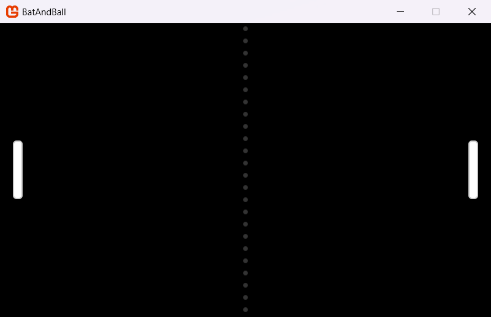
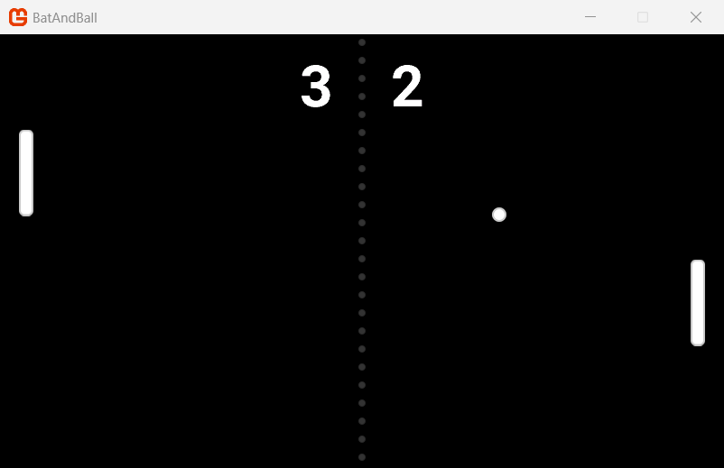

In this step, you will use the content from [Step 4](../04_adding_content/index.md) to make a two player bat and ball game, which we make in seven small parts. Each part adds one feature and after each part, you run the game and see the result.

In this step, you will:

- Draw the court and the bats.
- Move the bats with the keyboard.
- Add a ball that moves and bounces.
- Find collisions between the ball and the bats.
- Keep the score.
- Add sound.

## The rules of the game

- Two players use one keyboard. Each player moves a bat up and down.
- A ball moves across the screen. It bounces off the top edge, the bottom edge and the bats.
- When the ball goes off the left or right edge, the other player gets one point.
- A gray dotted line shows the middle of the screen. The score shows at the top.

| Player | Up | Down |
| --- | --- | --- |
| Player 1 (left bat) | `W` | `S` |
| Player 2 (right bat) | `Up` arrow | `Down` arrow |

## Before you start

Open the `Source/Game1.cs` file from the end of Step 4. From here, the code examples show only the code that changes, for ease of reading, new lines are highlighted. Put the new lines in the same place in your file.

> [!TIP]
> You can delete the `// TODO` comments from the template. The examples in this step do not show them.

## Part 1: Draw the court

A game needs an area to play in. This game uses a black screen with a gray dotted line down the middle. The line shows the side of each player. To draw the dots, the game uses the ball texture at a small size so that you do not need another texture.

> [!NOTE]
> At this stage, the tutorial assumes you have implemented all the code from the previous chapters, especially [Chapter 4](../04_adding_content/index.md), so if you see lines not highlighted and not in your project, it means you skipped something!

1. Add a field for the ball texture, below the `_batTexture` field:

    [!code-csharp]

2. In `LoadContent`, load the ball texture:

    [!code-csharp]

3. In `Draw`, make the following changes:

    - Change `Color.CornflowerBlue` to `Color.Black`.
    - Remove the line that draws the bat at position (100, 100). Part 2 draws the bats in their correct positions.
    - Add the code that draws the dotted line.

    [!code-csharp]

The `for` loop draws one dot every 20 pixels, from the top of the screen to the bottom, and each dot is an 8 by 8 pixel [**Rectangle**](xref:Microsoft.Xna.Framework.Rectangle). When you give `SpriteBatch.Draw` a rectangle, it scales the texture to fill the rectangle, so `middle - 4` puts the center of each dot on the middle of the screen.

`Color.White * 0.2f` makes the color 80% transparent. On a black screen, a transparent white dot looks gray.

Run the game. The screen is black, with a gray dotted line down the middle.

## Part 2: Add the bats

Each player needs a bat. The game keeps the position of each bat in a [**Vector2**](xref:Microsoft.Xna.Framework.Vector2) field which holds two values, `X` and `Y`.

Later in Part 3, we will update the game to change the `Y` value and move the bats, or move the position at which the bats will be drawn.

1. Add two fields for the bat positions:

    [!code-csharp]

2. In `LoadContent`, set the start position of each bat:

    [!code-csharp]

    > [!NOTE]
    > We are initializing the position of the Bats in `LoadContent` and not `Initialize` because we also need to know the dimensions of the `_batTexture` to place the Bat.  Avoid hardcoding asset dimensions on what you "think" the scale of an asset will be. You should always check first!

3. In `Draw`, draw the two bats:

    [!code-csharp]

`GraphicsDevice.Viewport.Bounds` gives the size of the screen, whereas the position of a texture is its top-left corner. Thus, the code subtracts the bat height from the screen height and divides them by two, to put each bat in the vertical middle.

- The left bat is 20 pixels from the left edge.
- The right bat is 20 pixels from the right edge.

So the code also subtracts the bat width to determine its absolute position.

Run the game. The two bats show at the left and right edges.

|  |
| :---: |
| **Figure 6-1: The court and the two bats** |

## Part 3: Move the bats

For this sample. the players move the bats with the keyboard. The game however, must be able to move objects at the same speed on fast and slow computers, so to achieve this, the game multiplies the speed by the time since the last frame.

1. Add a constant for the speed of the bats, at the top of the class:

    [!code-csharp]

    The speed is in pixels each second.

    > [!NOTE]
    > It is a common coding practice to try and structure your code files for easy reading later, `const` / `static` variables at the top, followed by `private` and then `public` variables.  This is not a law, just a good idea to follow and be a helpful developer.

2. Then add the following new method below the `Draw` method:

    [!code-csharp]

    `GetDirection` reads two keyboard keys, determining that:

    - `-1` to move up
    - `1` to move down
    - and `0` to stay.

    In MonoGame, the `Y` value increases from the top of the screen to the bottom. Thus, `-1` moves a bat up.

3. Finally, in `Update`, add the following code that moves the bats, below the template code that exits the game:

    [!code-csharp]

    > [!TIP]
    > If you wanted to be smarter about it, you could place the `KeyboardState keyboard = Keyboard.GetState();` call **BEFORE** the exit call and then replace `Keyboard.GetState().IsKeyDown` with simply `keyboard.IsKeyDown` to remove the extra `GetState` call.  
    >
    > But this is a static call and does not save much.  But it is cleaner and what most projects do.

This code does these tasks:

- [**Keyboard.GetState**](xref:Microsoft.Xna.Framework.Input.Keyboard.GetState) gets the state of all the keys.
- `elapsed` is the time in seconds since the last frame, which comes from [**GameTime**](xref:Microsoft.Xna.Framework.GameTime) provided to the `Update` method.
- Each bat moves by its direction, multiplied by the speed and elapsed time.
- [**MathHelper.Clamp**](xref:Microsoft.Xna.Framework.MathHelper.Clamp(System.Single,System.Single,System.Single)) keeps each bat between the top edge and the bottom edge of the screen, so values cannot exceed the expected size of the screen.

Run the game. Use `W` and `S` to move the left bat. Use the `Up` and `Down` arrow keys to move the right bat.

## Part 4: Add the ball

The ball has a position and a *velocity*. The velocity is the speed and the direction of the ball, in pixels each second, during each frame, the game adds the velocity, multiplied by the elapsed time, to the current position. This is the basic physics of the game.

1. At the top of the file, add `using System;`. The `Random` class, which this part uses, is in the `System` namespace.

    [!code-csharp]

2. Add a constant for the start speed of the ball, and two fields for its position and velocity:

    [!code-csharp]

3. Add this method below the `GetDirection` method:

    [!code-csharp]

    `ResetBall` *serves* the ball. It puts the ball in the middle of the screen, then it sets the velocity.

    - A `direction` of `1` causes the ball to move to the right.
    - A `direction` of -1 sends it to the left.
    - A random vertical speed makes each serve different.

4. At the end of `LoadContent`, serve the ball:

    [!code-csharp]

5. In `Update`, below the code that moves the bats, move the ball:

    [!code-csharp]

6. Below this line, we then bounce the ball off the top and bottom edges:

    [!code-csharp]

    When the ball touches the top or bottom edge, the code changes the sign of the vertical velocity. Thus, the ball goes in the opposite vertical direction. The code also examines the direction of the ball, and changes it only if the ball moves toward the edge. This prevents a problem where the ball stays at the edge and changes direction in each frame.

    > [!NOTE]
    > This is a common practice in basic collision detection, you determine if the object has or is about to go out of bounds AFTER you move it, then apply a correction to either stop it or move it off on a new direction.

7. Below the bounce code, serve the ball again when it goes off the left or right edge:

    [!code-csharp]

    When the ball goes fully off one edge, the code serves it toward the player who lost the point. Part 6 adds the points.

    > [!NOTE]
    > This is another common technique, when an object moves out of visible view, either destroy it, or in this case, just start drawing immediately elsewhere as if it is new.  The beginner 2D tutorial also does this [when a bat is eaten](https://docs.monogame.net/articles/tutorials/building_2d_games/12_collision_detection/index.html#adding-collision-to-our-game).
    >
    > the [Building 2D games](https://docs.monogame.net/articles/tutorials/building_2d_games/12_collision_detection/index.html) goes into a LOT more detail regarding collision detection, if you want to tackle that tutorial next.

8. In `Draw`, draw the ball after the bats:

    [!code-csharp]

Run the game. The ball now draws and moves, and will bounce off the top and bottom edges, as well as resetting if it goes off the screen. However, it will go straight through any bats because the game does not handle collisions yet.

## Part 5: Hit the ball with the bats

To find a *collision*, the game creates a rectangle around the ball and another rectangle around each bat (we do not draw these, they are only for the game to see). If the two rectangles touch, the two objects are touching.

1. Add this method after the `ResetBall` method:

    [!code-csharp]

    `GetBounds` makes a new [**Rectangle**](xref:Microsoft.Xna.Framework.Rectangle) based on a position and the size of a texture.

2. Now, add this method below the `GetBounds` method:

    [!code-csharp]

    `HitBall` sends the ball back and changes the direction of the horizontal velocity, this makes the ball 5% faster each time it hits something. Then, it sets a new vertical velocity from the position where the ball hit the bat. A hit near the center of the bat sends the ball straight. A hit near the end of the bat sends the ball off at a steep angle. Thus, the players can aim the ball.

    > [!NOTE]
    > You might wonder, why keep creating all these separate methods while writing my game?  The simple answer is "reusability", you want to keep blocks of code that do a single job together and bound in their own "method" call.  That way you can keep reusing them wherever you need then without duplicating code.

3. In `Update`, below the code that bounces the ball off the edges, add the collision code:

    [!code-csharp]

    [**Rectangle.Intersects**](xref:Microsoft.Xna.Framework.Rectangle.Intersects(Microsoft.Xna.Framework.Rectangle)) is true when two rectangles touch, meaning a collision has happened, either touching or overlapping.

    The code also examines the direction of the ball, for example, the left bat hits the ball only if the ball moves to the left. Thus, the ball bounces only one time, also if it touches the bat for more than one frame.

Run the game. Hit the ball with the bats and hit the ball with the end of a bat to send it at an angle.

## Part 6: Keep the score

Each player gets one point when the ball goes off the other player's edge, however the game is not currently drawing that to the scene. For this section, the game will show the score at the top of the screen with the SpriteFont you created and imported from [Step 4](../04_adding_content/index.md#add-a-font).

1. Add a field for the font, and two fields for the points of each player:

    [!code-csharp]

2. In `LoadContent`, load the font:

    [!code-csharp]

    > [!IMPORTANT]
    > If you did not create and add the Font to your `Content` project, then your game will crash at this point with a `ContentLoadException`. Simply put, you forgot to add it and then it cannot be found (or the name / path is wrong or a typo).

3. In `Update`, give a point to player 2 when the ball goes off the left edge:

    [!code-csharp]

4. Give a point to player 1 when the ball goes off the right edge:

    [!code-csharp]

5. In `Draw`, draw the score after the ball:

    [!code-csharp]

[**SpriteFont.MeasureString**](xref:Microsoft.Xna.Framework.Graphics.SpriteFont.MeasureString(System.String)) gives the size of the text in pixels and the code uses this size to put the text in the middle of the screen. The spaces in the text keep the two numbers on the two sides of the dotted line.

Run the game. The score shows at the top of the screen and increases when a player misses the ball.

> [!NOTE]
> If the text is small, that simply means you did not edit the `Score.spritefont` and update the `Size` field, which defaults to `14`.  Just update the number to `40` as originally instructed.
>
> MonoGame does this so you can have many `SpriteFont`'s with varying sizes using the same font.  It has to be done this way as MonoGame actually generates a texture atlas when the font is built using the `spritefont` definition, and that is what is rendered to the screen, not the font itself.

## Part 7: Add sound

Sound tells the players when something collides in the game, for which we are using one [**SoundEffect**](xref:Microsoft.Xna.Framework.Audio.SoundEffect) for all three events. It plays the sound with a different volume and pitch for each event:

| Event | Volume | Pitch |
| --- | --- | --- |
| The ball hits a bat | Full | Normal |
| The ball bounces off the top or bottom edge | Half | Lower |
| A new serve | Full | One octave lower |

[**SoundEffect.Play(volume, pitch, pan)**](xref:Microsoft.Xna.Framework.Audio.SoundEffect.Play(System.Single,System.Single,System.Single)) sets these values, with:

- A volume ranging from 0 to 1.
- The pitch is from -1 (one octave lower) to 1 (one octave higher).
- The pan is from -1 (left speaker) to 1 (right speaker).

1. At the top of the file, add `using Microsoft.Xna.Framework.Audio;`:

    [!code-csharp]

2. Add a field for the sound:

    [!code-csharp]

3. In `LoadContent`, load the sound:

    [!code-csharp]

    > [!IMPORTANT]
    > Load the sound before the `ResetBall(1)` line. As `ResetBall` plays the sound immediately, so the sound must be loaded first.

4. At the end of the `HitBall` method, play the sound:

    [!code-csharp]

5. In `Update`, play the sound at half volume and a lower pitch when the ball bounces off an edge:

    [!code-csharp]

6. At the end of the `ResetBall` method, play the sound one octave lower:

    [!code-csharp]

Run the game and you will hear the serve sound when the game starts, then again for each hit and each bounce.

|  |
| :---: |
| **Figure 6-2: The completed bat and ball game** |

> [!TIP]
> If your game does not operate correctly, compare your code with the [complete `Game1.cs` file](./snippets/07_sound.cs).

## Things to try

Use these changes to learn more:

- Change `BatSpeed` and `BallSpeed`, then play the game again.
- Change the colors in the `Draw` method. For example, use `Color.MonoGameOrange` for the bats.
- Use the `pan` value to play the bat sound from the side of the bat that hits the ball.
- Stop the game when one player gets 10 points, and show the winner.
- Add gamepad input with [**GamePad.GetState**](xref:Microsoft.Xna.Framework.Input.GamePad.GetState(Microsoft.Xna.Framework.PlayerIndex)).
- Make the right bat move by itself, so that one person can play. (See [AutoPong](https://github.com/MonoGame/MonoGame.Samples/tree/3.8.5/AutoPong) the official MonoGame sample this guide was based on for ideas)

To play the game on a phone or tablet, refer to [Appendix: Going Mobile](../appendix_going_mobile/index.md).

## Next steps

You have completed this guide. To learn more, use these resources:

- [Building 2D Games](../../building_2d_games/index.md): a full tutorial that makes a complete game, from setup to publishing.
- [The Content Builder](../../../getting_started/content_pipeline/content_builder/index.md): more information about how to build content.
- [What is MonoGame?](../../../getting_to_know/whatis/index.md): the MonoGame concepts and the API.

## Conclusion

In this step, you accomplished the following:

- You drew a court, two bats and a ball.
- You moved the bats with keyboard input and the elapsed time.
- You used velocity and simple physics to move and bounce the ball.
- You found collisions with rectangles.
- You kept the score and drew it with a SpriteFont.
- You played a sound effect with different volumes and pitches.

## Test Your Knowledge

1. Why does the code multiply each speed by the elapsed time?

    :::question-answer
    The elapsed time is the time since the last frame. If you multiply the speed by this time, objects move at the same speed on fast and slow computers.
    :::

2. How does the code make the ball bounce off the top edge?

    :::question-answer
    It changes the sign of the vertical velocity (`_ballVelocity.Y = -_ballVelocity.Y`). Thus, the ball goes in the opposite vertical direction.
    :::

3. Which method finds a collision between the ball and a bat?

    :::question-answer
    `Rectangle.Intersects`. It is true when the rectangle of the ball touches the rectangle of the bat.
    :::

4. Why must the code load the sound before the `ResetBall(1)` line in `LoadContent`?

    :::question-answer
    `ResetBall` plays the sound. If the sound is not loaded, the `_hitSound` field is `null` and the game stops with an error.
    :::
