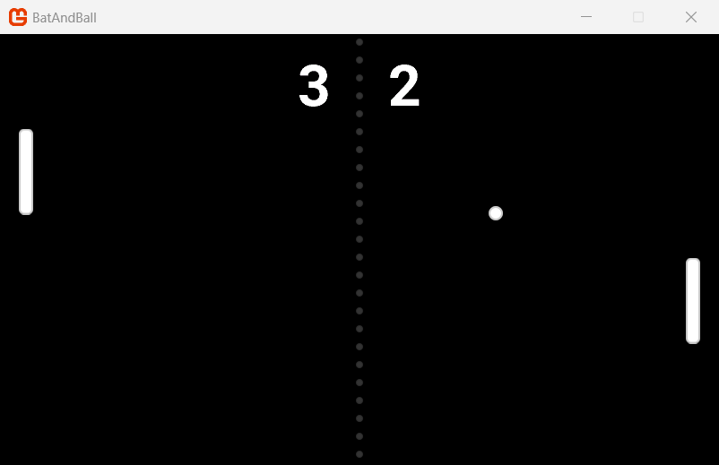

This guide shows you how to get started with MonoGame. In six short steps, you will prepare your computer, create a project and make a basic two player bat and ball game.

|  |
| :---: |
| **Figure 0-1: The bat and ball game that you make in this guide** |

## Who this guide is for

This guide is for developers who are new to MonoGame, it is recommended to be familiar with the basics of C# but you do not need to know about game development.

> [!TIP]
> If you want a longer, more detailed tutorial, read the [Building 2D Games](../building_2d_games/index.md) tutorial after this guide.

## What you need

- A computer with Windows, macOS or Linux.
- An internet connection, to download the tools.
- MonoGame 3.8.6 or later (which this guide will show you how to set up)
- A graphics driver that supports OpenGL, Vulkan and on Windows, the guide also uses DirectX 11/12.

    > [!NOTE]
    > Mobile iOS and Android are also supported by MonoGame, as well as most modern consoles.  But these are beyond the scope of this beginners guide.

## The steps

| Step | Summary |
| --- | --- |
| [Step 1: Prepare Your Operating System](01_setting_up_your_os/index.md) | Install the .NET SDK and the MonoGame templates on Windows, macOS or Linux. |
| [Step 2: Choose Your IDE](02_choosing_your_ide/index.md) | Install and configure Visual Studio, Visual Studio Code or JetBrains Rider. |
| [Step 3: Create a New Project](03_creating_a_project/index.md) | Select your platforms, then create a project from the MonoGame Empty Game template and run it. |
| [Step 4: Add Content with the Content Builder](04_adding_content/index.md) | Add a texture, a sound effect and a font to your project, then show them on the screen. |
| [Step 5: Understand the Code](05_understanding_the_code/index.md) | Learn about the project setup, the `Game1` class and the game loop. |
| [Step 6: Make a Basic Game](06_a_basic_game/index.md) | Make a two player bat and ball game, one part at a time, with movement, collisions, a score and sound. |
| [Appendix: Going Mobile](appendix_going_mobile/index.md) | Tips to play the game on Android and iOS devices. |

## How to use this guide

Perform each step in sequence, as each step uses the results of the previous step before it.  E.G. Set up your machine, then your IDE and finally create your game.

Some sections have tabs for your operating system or your IDE. When you select a tab, the other sections on the page show the same tab.

> [!TIP]
> If you have a problem, refer to [Help and Support](../../help_and_support.md).
